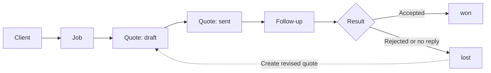
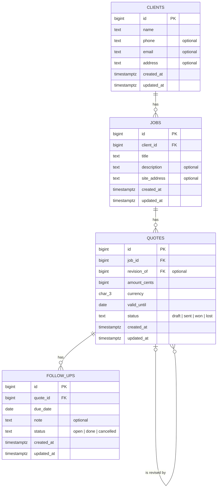

# QuoteLoop: Design

QuoteLoop helps service businesses track quotes from first contact to a final result (won or lost) and makes sure no quote is forgotten.

## Flow

## Database schema

## Rules

1. **Active quote:** A quote is active if its status is `draft` or `sent`. A Job can have at most one active quote, enforced by a partial unique index on `job_id` where status is in (`draft`, `sent`).

2. **Statuses:** `draft → sent → won | lost`. `expired` is derived, not stored: a `sent` quote whose `valid_until` is in the past. No cron job is needed.

3. **Revisions:** If a client rejects a quote and you offer a new price, mark the old quote `lost` and create a new one with `revision_of` pointing to it. The referenced quote must belong to the same Job.

4. **Follow-ups:** A quote can have many follow-ups over its life, but only one can be `open` at a time, enforced by a partial unique index. When a quote becomes `won` or `lost`, its open follow-up becomes `cancelled`.

5. **Won jobs:** A Job with a `won` quote is closed. New work must be recorded as a new Job; the application must not create another quote for a won Job.

6. **Default follow-up:** When a quote is sent, the UI suggests a follow-up 3 days out, pre-filled and editable.

7. **Timezone:** “Today” for dashboard follow-ups is computed in the business’s timezone, initially `America/Toronto`.

8. **Dashboard:** It shows `sent` quotes with an open follow-up due today or earlier. It also shows a second list of `sent` quotes with no open follow-up, so nothing gets forgotten.

9. **Money:** Store integer cents plus a currency code, never floats.

10. **Naming:** Keep generic terms in the UI (“Client”, “Job”), nothing industry-specific.

## Example scenario

A painter logs a call from Mr. Smith, adds the job “Paint living room”, creates a quote for CAD 1,250, and marks it `sent`. They set a follow-up for 3 days later. After the call, the client accepts and the quote becomes `won`.

## Out of scope for v1

- Email and SMS reminders; reminders live only in the dashboard.
- Payments.
- Authentication beyond the basics.