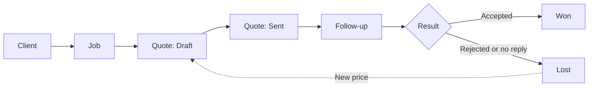

# QuoteLoop: Design

QuoteLoop helps service businesses track quotes from first contact to a final result (Won or Lost) and makes sure no quote is forgotten.

## Flow

## Data model

| Entity | Fields |
|---|---|
| Client | name, phone, email, address |
| Job | title, description, site address, client_id |
| Quote | job_id, amount_cents (bigint), currency (default `CAD`), valid_until, status, `revision_of` (nullable quote_id) |
| Follow-up | quote_id, due_date, note, status (`open` / `done` / `cancelled`) |

## Rules

1. **Active quote:** A quote is active if its status is `Draft` or `Sent`. A Job can have at most one active quote, enforced by a partial unique index on `job_id` where status is in (`Draft`, `Sent`).
2. **Statuses:** `Draft -> Sent -> Won | Lost`. `Expired` is derived, not stored: a `Sent` quote whose `valid_until` is in the past. No cron job is needed.
3. **Revisions:** If a client rejects a quote and you offer a new price, mark the old quote `Lost` and create a new one with `revision_of` pointing to it.
4. **Follow-ups:** A quote can have many follow-ups over its life, but only one can be `open` at a time (another partial unique index). When a quote becomes `Won` or `Lost`, its open follow-up becomes `cancelled`.
5. **Default follow-up:** When a quote is sent, the UI suggests a follow-up 3 days out, pre-filled and editable.
6. **Dashboard:** It shows `Sent` quotes with an open follow-up due today or earlier. It also shows a second list of `Sent` quotes with no open follow-up, so nothing gets forgotten.
7. **Money:** Store integer cents plus a currency code, never floats.
8. **Naming:** Keep generic terms in the UI ("Client", "Job"), nothing industry-specific.

## Example scenario

A painter logs a call from Mr. Smith, adds the job "Paint living room", creates a quote for CAD 1,250 and marks it `Sent`. They set a follow-up for 3 days later. After the call, the client accepts and the quote becomes `Won`.

## Out of scope for v1

- Email and SMS reminders (reminders live only in the dashboard)
- Payments
- Authentication beyond the basics